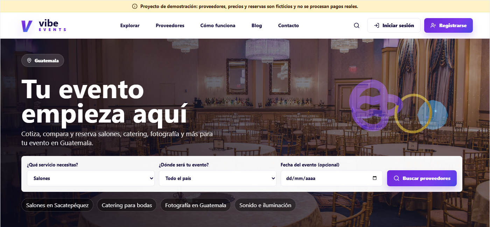
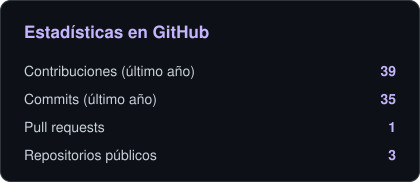
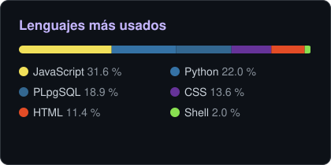

<!-- Banner -->


<div align="center">

<a href="https://github.com/Gaston1x">
  
</a>

<br/><br/>

<a href="https://www.linkedin.com/in/maycol-ortiz/"></a>
<a href="https://gaston1x.github.io/vibe-events/"></a>


</div>

---

### 👋 Sobre mí

```js
const maycol = {
  ubicacion: "Guatemala 🇬🇹",
  rol: "Full Stack Developer",
  trabajoActual: "Operations Floor Coach @ HCLTech",
  enfoque: ["APIs REST", "Bases de datos relacionales", "Interfaces accesibles"],
  meImporta: ["código probado", "seguridad", "privacidad del usuario"],
};
```

- 🔭 Construyo proyectos **full stack**: desde la base de datos y la API hasta la interfaz.
- 🗄️ Me especializo en **bases de datos**: diseño de esquemas, triggers en PL/pgSQL, auditoría y T-SQL.
- ✅ Trabajo con mentalidad **QA**: pruebas automatizadas, CI en GitHub Actions y cero vulnerabilidades conocidas.
- ♿ Diseño pensando en **todas las personas**: accesibilidad WCAG 2.1 AA y privacidad por defecto.

---

### 🛠️ Tecnologías

<div align="center">

**Lenguajes**<br/>


**Frontend**<br/>


**Backend y bases de datos**<br/>


**Herramientas**<br/>


</div>

---

### 🚀 Proyectos destacados

<table>
  <tr>
    <td width="50%" valign="top">
      <a href="https://github.com/Gaston1x/vibe-events"></a>
      <h3>🎉 Vibe Events</h3>
      <p>Marketplace para cotizar, comparar y reservar proveedores de eventos en Guatemala.</p>
      <ul>
        <li>Registro e inicio de sesión con <b>JWT</b> y <b>bcrypt</b></li>
        <li>Privacidad: consentimientos, baja de correos y eliminación de cuenta</li>
        <li>Accesibilidad <b>WCAG 2.1 AA</b> y auditoría QA (16 defectos corregidos)</li>
      </ul>
      <p>
        
        
        
      </p>
      <a href="https://gaston1x.github.io/vibe-events/"><b>Ver demo</b></a> · <a href="https://github.com/Gaston1x/vibe-events"><b>Código</b></a>
    </td>
    <td width="50%" valign="top">
      <a href="https://github.com/Gaston1x/autoaudit"></a>
      <h3>🛡️ AutoAudit</h3>
      <p>Sistema de auditoría automatizado para PostgreSQL 18: registra quién cambió qué, cuándo y desde dónde.</p>
      <ul>
        <li>Triggers en <b>PL/pgSQL</b> generados dinámicamente</li>
        <li>Bitácora inmutable y consultas de “viaje en el tiempo”</li>
        <li><b>81 pruebas</b> automáticas y pruebas con +1 millón de registros</li>
      </ul>
      <p>
        
        
        
      </p>
      <a href="https://github.com/Gaston1x/autoaudit"><b>Código y documentación</b></a>
    </td>
  </tr>
</table>

---

### 📊 Estadísticas

<div align="center">





</div>

<!-- Footer -->

